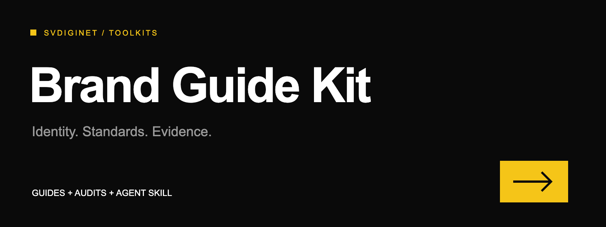

# Brand Guide Kit



**Create consistent brand guides. Audit the files behind them.**

A documentation-first toolkit by SVDIGINET: original standards, templates and an agent skill for practical brand handoffs. Works with Claude Code, Codex, or a human reviewing a guide.

## Start here

1. Read [the standard](docs/brand-system-standard.md).
2. Fill [the guide brief](templates/brand-guide.md) with verified facts and approved references.
3. Audit with [the audit template](templates/audit.md). Mark every criterion VERIFIED, MISSING or UNKNOWN.
4. For dimensional work use [the 3D specification](templates/3d-spec.md).
5. Run `python3 scripts/check.py` to validate this repository's documentation integrity. It does not certify a brand or audit external assets.

## Brand contracts and asset checks

Use [the local brand auditor](docs/brand-contract.md) to check declared SVG byte baselines, palette literals and live text. Its exporter copies pinned approved SVG bytes into a new folder; it does not generate artwork or certify visual quality. No third-party runtime dependency.

## Agent skill

Read [skills/brand-guide-kit/SKILL.md](skills/brand-guide-kit/SKILL.md). The skill links to the same maintained criteria and templates; no separate copy of the rules.

### Install locally

Clone this repository into a location you control. Then, replacing `/absolute/path/brand-guide-kit` below with that checkout, create links only where no installation exists:

```sh
mkdir -p ~/.claude/skills ~/.codex/skills
ln -s /absolute/path/brand-guide-kit/skills/brand-guide-kit ~/.claude/skills/brand-guide-kit
ln -s /absolute/path/brand-guide-kit/skills/brand-guide-kit ~/.codex/skills/brand-guide-kit
```

Do not overwrite existing installations. Update through ordinary Git review and pull; no scheduler, network fetch or auto-update hook is installed. Both agents must have access to the checkout.

## Scope

Logo fidelity, portable typography, responsive marks, functional icons, color, reproducible 3D, applications, export QA and asset governance. Existing brand identity wins over external examples. The kit does not generate production-ready logos, prove trademark clearance, measure embroidery, or substitute a physical proof.

## References and rights

[Official references](docs/references.md) link to public brand resources. No third-party logos, fonts, screenshots or manuals are redistributed. No client assets or private brand notes are included.

**License: MISSING (owner decision pending).** Public visibility does not grant a reuse license. Do not describe this release as open source or copy it into commercial distributions until the owner chooses a license. Referenced brands retain their own rights.

## Maintain

Use [the maintenance checklist](routines/README.md) when sources or assets change. [Roadmap](ROADMAP.md), [changelog](changelog.md), [review rules](REVIEW.md).
